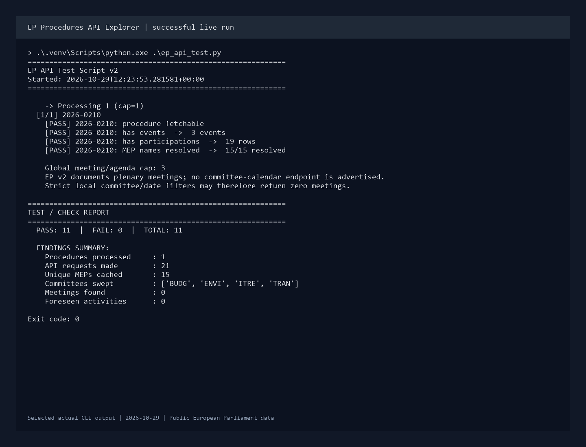

# EP Procedures API Explorer

Turn European Parliament procedure feeds into CSV and JSON files for research and reporting. The script collects procedure details, resolves MEP names, and explores meeting references where the API supplies matching data. This makes the API easier to inspect without manually joining responses from several endpoints. The current API documents plenary meetings, so this tool cannot promise a committee agenda calendar.

This is a command-line data exploration tool. Its checks describe what the selected API responses contain; they are not a guarantee that a procedure or agenda is complete.

## Preview



This image renders selected output from the user's live run on 2026-10-29. See the [terminal excerpt](docs/sample-output.txt) and [sample report with original exports](docs/sample-report/README.md).

The run exited with code 0: 1 procedure, 19 participations, 3 events, 15 resolved MEPs, and 11 passing checks across 21 HTTP requests. Plenary rows were correctly excluded from the committee sweep, leaving zero matching meetings and no agenda-detail calls. This verifies the procedure workflow and meeting filters; agenda response handling was verified offline.

## What it does

1. Reads the Atom feed for DEA and COD procedures updated today. If it is empty, it tries a configurable lookback period.
2. Collects procedure metadata, events, participations, and scheduled activities.
3. Resolves MEP details and caches them locally to reduce repeat requests.
4. Requests meetings for the window's year(s), then keeps only rows with an ID date inside the window and explicit evidence of the requested committee. Plenary, undated, and unknown-committee rows are discarded.
5. Cross-references foreseen activities with tracked procedure IDs and exports results with a pass/fail report.

## Run locally

Requires Python 3.12 or newer. No API key or account is needed.

```bash
git clone https://github.com/miahela/ep-procedures-api.git
cd ep-procedures-api
python -m venv .venv
```

Activate the virtual environment:

```powershell
# Windows PowerShell
.\.venv\Scripts\Activate.ps1
```

```bash
# macOS / Linux
source .venv/bin/activate
```

Install dependencies:

```bash
python -m pip install -r requirements.txt
```

Defaults work without a configuration file. To change them, copy `.env.example` to `.env`:

```powershell
# Windows PowerShell
Copy-Item .env.example .env
```

```bash
# macOS / Linux
cp .env.example .env
```

Then run from the project directory:

```bash
python ep_api_test.py
```

Files are written to `ep_api_test_v2_output/` by default. The directory is created on startup. The script does not install packages automatically.

## Configuration

The `.env` beside `config.py` provides optional settings. Existing environment variables take precedence. No source edits are needed for these values.

| Variable | Default | Purpose |
|---|---|---|
| `EP_BASE_URL` | `https://data.europarl.europa.eu/api/v2` | API base URL |
| `EP_OUTPUT_DIR` | `ep_api_test_v2_output` | Export folder, relative to your current directory |
| `EP_TIMEOUT` | `30` | Request timeout in seconds, greater than 0 |
| `EP_REQUEST_DELAY` | `0.5` | Delay before each request, at least 0 |
| `EP_MAX_PROCEDURES` | `50` | Maximum number of unique feed procedures to process |
| `EP_LOOKBACK_MONTHS` | `3` | Feed fallback, approximated as 30 days per month |
| `EP_MEETINGS_HORIZON` | `50` | Number of days ahead to query meetings |
| `EP_MAX_MEETINGS` | `20` | Global cap on processed meetings and agenda-detail requests, across all committees |

Procedure caps and date horizons must be positive integers. Invalid configuration fails before requests begin. `.env` and the default generated output folders are ignored by Git. If you choose another output folder, add it to `.gitignore` before sharing the repo.

For a smaller exploratory run, use a separate folder and set these values in `.env`:

```dotenv
EP_MAX_PROCEDURES=2
EP_MEETINGS_HORIZON=7
EP_MAX_MEETINGS=3
EP_OUTPUT_DIR=ep_api_test_output
```

The procedure cap does not cap total HTTP requests. Each procedure can trigger MEP lookups and meeting-list requests. `EP_MAX_MEETINGS` separately caps agenda-detail requests across the whole run, with duplicate meeting IDs processed only once. Keep a request delay suitable for the API.

### Meeting endpoint coverage

The [official v2 specification](https://data.europarl.europa.eu/api/v2) lists `year`, `format`, `offset`, and `limit` for `/meetings`. It does not support `body-id`, `start-date`, or `end-date`; those parameters have been removed. The script requests the relevant year(s) with `offset=0` and `limit=50`, then applies its own inclusive date and committee filters even if the server ignores the query.

Dates come from the meeting ID. Committee membership must appear as an exact committee token in the ID or in explicit organization/body metadata. `MTG-PL-...` and `GMTG-PL-...` plenary IDs are always rejected for a committee sweep. The current specification describes agenda details for plenary sittings and advertises no committee-calendar endpoint. The script does not invent a replacement endpoint. Zero matching meetings does not prove that a committee has no meetings.

## Export files

| File | Contents |
|---|---|
| `procedures_meta.json` / `procedures_meta.csv` | Procedure IDs, types, titles, stages, and row counts |
| `participations_resolved.csv` | Participation roles with resolved MEP names and nationality |
| `events.csv` | Events embedded in procedure objects |
| `scheduled_from_procedure.csv` | Scheduled activities embedded in procedures |
| `meetings.csv` | Meetings returned for the selected committees and horizon |
| `foreseen_activities.csv` | Agenda items returned for those meetings |
| `foreseen_cross_refs.csv` | Agenda items referencing tracked procedure IDs |
| `mep_cache.json` | MEP lookup cache, reused across runs |
| `activity_type_inventory.json` | Counts of activity types found in procedures |
| `test_report.json` / `test_report.csv` | Named checks with PASS/FAIL results and details |

CSV files are only written when there are rows. JSON exports and nonempty CSV exports overwrite their previous versions. A previously generated CSV can remain when a later run has no rows, so use a fresh output directory when comparing runs.

## Errors and current limits

- JSON requests log their HTTP status and URL. For agenda details, 204, 404, and empty/whitespace bodies return zero items without a FAIL. Other non-200 responses and non-timeout transport errors are logged and skipped. Timeouts, 5xx responses (including empty ones), and invalid nonempty HTTP 200 JSON/envelopes count as agenda failures. Collecting zero agenda items is informational, not a failed check.
- Missing dependencies, invalid settings, unreadable output paths, and malformed MEP cache files produce a short error instead of an automatic install or an unhandled traceback. Back up and repair or remove an invalid cache before running again.
- If both feed attempts return no procedures, the script exits with an error before exporting the final report. An empty period and a failed feed request are both possible causes; inspect the console messages.
- Other failed checks are saved in the report but do not make the process exit with a failure code. Inspect the final PASS/FAIL summary rather than relying on the exit code alone.
- Requests are not retried automatically, and pagination is not implemented. Meeting collection uses only the first response page, so filtered results can be incomplete even when they are below the cap. Reaching the meeting cap is printed and remaining meetings are skipped.
- MEP cache entries have no expiry. Empty results from unsuccessful lookups can be cached too; remove the relevant entry or use a fresh cache to retry it.
- Procedure matching uses substring checks against agenda references. It is useful for exploration, but does not validate an exact legislative relationship.
- The committee list and nested-field assumptions remain in the script. API schema changes can require updates.

## Checks

Run `python -m unittest discover -s tests -v` for offline fixture checks of exports, cross-references, HTTP/empty responses, cache errors, ignored date/committee filters, the 708-plenary-row case, and per-run meeting caps. Synthetic committee-shaped rows test the defensive filters; they do not imply that the live endpoint supplies committee calendars.

## Stack

Python, requests, the standard-library XML parser, CSV/JSON utilities, and python-dotenv. Data comes from the [European Parliament Open Data API](https://data.europarl.europa.eu/en/developer-corner).

```text
ep-procedures-api/
  ep_api_test.py     Feed, detail, meeting, and report workflow
  config.py          Validated environment defaults
  .env.example       Optional configuration template
  requirements.txt   Runtime dependencies
  tests/             Offline workflow and regression checks
  docs/              Live-run screenshot, excerpt, and sample exports
```
